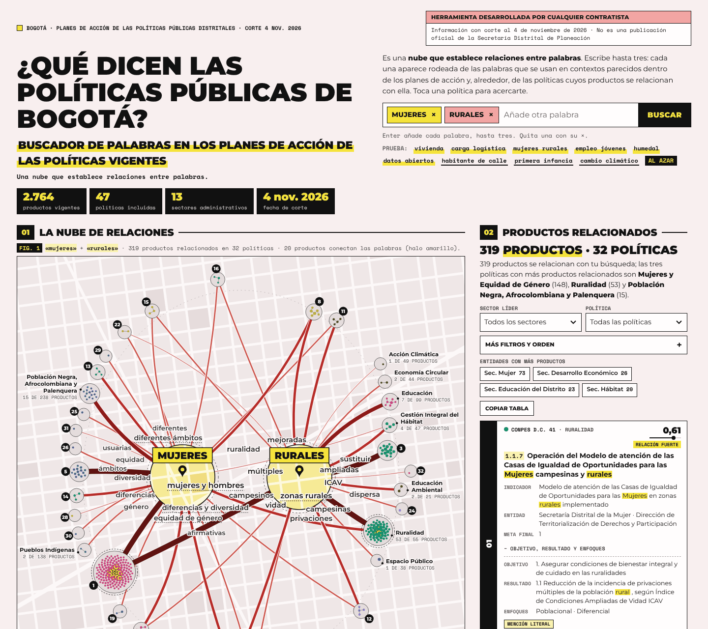

# ¿Qué dicen las Políticas Públicas de Bogotá?

**Buscador de palabras en los planes de acción de las políticas vigentes.**

> Herramienta desarrollada por **Cualquier Contratista** a partir de información pública, con corte al **4 de noviembre de 2026**.
> **No es una publicación oficial de la Secretaría Distrital de Planeación.**



*En el teléfono:* [búsqueda «habitante de calle»](docs/capturas/movil.png).

Escribe una palabra, o hasta tres, y el visor muestra qué productos de los planes de acción de las políticas públicas
distritales de Bogotá se relacionan con ella. Lo hace con una **nube que establece relaciones entre palabras**:

- la palabra buscada va al centro, rodeada de las palabras que se usan en contextos parecidos;
- alrededor quedan las políticas, con sus productos como puntos;
- una banda une cada política con la palabra: es más gruesa y más oscura cuanto más se relacionan sus productos con ella.

Cubre **2.764 productos vigentes de 47 políticas** en 13 sectores administrativos.

Todo el visor es **un solo archivo HTML** (`dist/index.html`, 2,8 MB). Trae dentro los datos, el modelo semántico y las tipografías.
Se abre sin conexión y no envía datos a ningún servidor.

## Qué se puede hacer

**Buscar**
- Hasta tres palabras o expresiones. «habitante de calle», «primera infancia» o «cambio climático» se leen como una sola unidad de significado.
- Mientras escribes, el buscador sugiere unidades y palabras, con cuántos productos las mencionan.
- Al tocar una palabra vecina, en la nube o en la lista que la acompaña, se suma a la búsqueda. La lista también se recorre con el teclado.

**Explorar la nube**
- Acercarse a una política para ver sus productos y su **perfil**: las palabras frecuentes en su plan y las tres políticas con textos más parecidos.
- Pasar sobre una política para ver el nivel de su banda con cada palabra.
- Partir de un producto con **«Productos parecidos»** para encontrar los de texto más cercano en todas las políticas.

**Filtrar y llevarse los resultados**
- Filtrar por sector líder, política, entidad responsable (con nombres normalizados), enfoque, fuerza de la relación, mención literal o productos que conectan dos palabras.
- Agrupar la lista por política o por entidad.
- Copiar la tabla filtrada para pegarla en una hoja de cálculo. La primera fila dice qué se buscó, con qué filtros, el corte, la versión y que no es una publicación oficial.

**Compartir**
- La búsqueda queda en la dirección de la página, por ejemplo `#q-mujeres-rurales`, y el enlace abre la misma búsqueda.

## Cómo funciona, en breve

1. **Los textos.** De cada producto se toman el nombre, que cuenta doble, el indicador y el resultado esperado.
2. **El peso de cada palabra.** Las palabras raras en el conjunto pesan más que las comunes (TF-IDF). Las que aparecen en más de uno de cada cinco productos, como «persona» o «estrategia», se descartan.
3. **Los temas de fondo.** El modelo resume en 128 temas cómo se usan las palabras juntas (análisis semántico latente, LSA). Las palabras que aparecen en contextos parecidos quedan cerca, aunque nunca compartan una frase. Por ejemplo, junto a «vivienda» quedan «habitacional», «VIS», «subsidio» y «arrendamiento».
4. **La relación.** La búsqueda se compara con cada producto con la similitud del coseno, de 0 a 1:
   - desde 0,30 es fuerte;
   - entre 0,18 y 0,30 es media.
5. **La nube.** Las políticas se ubican del lado de la palabra con la que más se relacionan. La banda marca la intensidad de la articulación temática: resume cuántos productos se relacionan y qué tan fuerte, por lo que crece con el tamaño del plan. No mide coordinación entre entidades.

La relación **no es un porcentaje** ni una medida de cumplimiento: indica cercanía de temas entre textos.
La explicación completa, con sus límites, está en [docs/metodologia.md](docs/metodologia.md).

## Datos

| | |
|---|---|
| **Fuente** | Planes de acción de las políticas públicas publicados por la Secretaría Distrital de Planeación ([sdp.gov.co](https://www.sdp.gov.co/gestion-socioeconomica/conpes-dc/politicas-publicas)) |
| **Corte** | 4 de noviembre de 2026 |
| **Universo** | 2.764 productos marcados como vigentes en su propio plan, de 47 políticas |
| **Quedan por fuera** | 1.086 productos no vigentes, cuatro planes cerrados sin columna de vigencia, un plan sin columna de productos, una fila vacía y una política sin plan publicado |

Los textos muy largos llegaron recortados en la extracción (los indicadores a 250 caracteres, los resultados y objetivos a 240). El visor los marca con «…» y el texto completo está en el plan oficial.

Los archivos y sus columnas están descritos en [docs/datos.md](docs/datos.md) y, para máquinas, en [datos/datapackage.json](datos/datapackage.json), que trae además el tamaño y la huella SHA-256 de cada archivo. Cómo actualizarlos para un nuevo corte: [docs/actualizar-datos.md](docs/actualizar-datos.md).

## Usarlo

- **Sin instalar nada:** descarga `dist/index.html` y ábrelo en el navegador.
- **En la web, con GitHub Pages:**
  1. Ve a *Settings → Pages* y elige *Source: GitHub Actions*.
  2. El flujo `.github/workflows/publicar.yml` publica `dist/` cada vez que la verificación pasa en la rama principal.
  3. El visor queda en `https://<usuario>.github.io/<repositorio>/`.

## Construir y verificar

Construir el visor solo necesita Python 3.9 o superior, sin paquetes adicionales:

```bash
python3 scripts/construir.py              # escribe dist/index.html a partir de datos/ y src/
python3 scripts/construir.py --comprobar  # falla si dist/index.html no está al día
python3 scripts/construir.py --huellas    # si cambió algo en datos/ o la versión: actualiza datos/datapackage.json
```

Las pruebas necesitan Node 18 o superior y, para las de navegador, Playwright para Python:

```bash
python3 pruebas/verificar.py --rapido     # construcción, determinismo, modelo (7/7), unidades y cifras de referencia
pip install -r pruebas/requirements.txt   # una vez; sin Chrome del sistema: python3 -m playwright install chromium
python3 pruebas/verificar.py              # además: recorridos en el navegador y medidas en 8 tamaños de pantalla
```

**Reentrenar el modelo semántico** solo hace falta si cambian los datos. Necesita numpy y scipy (las versiones con que se reprodujo están en `scripts/requirements.txt`), y el procedimiento está en [docs/actualizar-datos.md](docs/actualizar-datos.md):

```bash
pip install -r scripts/requirements.txt
python3 scripts/entrenar_modelo.py --salida /tmp/modelo.json --comparar datos/modelo/modelo_semantico.json
```

La arquitectura del código está explicada en [docs/arquitectura.md](docs/arquitectura.md).

## Estructura

```
datos/
  fuente/        productos y políticas vigentes (CSV, idénticos a la extracción) y verificación de la fuente
  catalogos/     catálogo de entidades con nombres normalizados
  modelo/        modelo semántico precalculado (TF-IDF + LSA, 128 dimensiones)
  pruebas/       consultas de control del modelo
  datapackage.json  metadatos de todos los archivos (Frictionless Data Package)
src/             plantilla HTML, estilos, tipografías, motor semántico y módulos de la aplicación
scripts/         construcción del visor, entrenamiento del modelo y capturas del README
pruebas/         pruebas en Node y en el navegador, y verificación completa
dist/            el visor construido: un solo archivo HTML
docs/            metodología, datos, arquitectura, actualización, revisión del comité y capturas
licencias/       licencias de las tipografías
```

## Límites

- **Mide cercanía temática entre textos.** No mide coordinación entre entidades, equivalencia jurídica, duplicidad de metas, presupuesto ni avance. Una relación alta es una pista para revisar los planes, no una conclusión. Que un tema no aparezca no prueba que no se trabaje.
- **Solo sabe lo que dicen estos textos.** Si una palabra aparece en pocos productos, sus vecinas reflejan esos pocos contextos.
- **No lee como una persona.** Cuenta palabras, no frases: no tiene en cuenta el orden ni las negaciones, y une singular y plural con una regla simple.
- **Los cortes son convenciones.** Los umbrales de 0,18 y 0,30 y los cinco niveles de las bandas sirven para leer, no son verdades estadísticas.
- **Textos recortados.** Los textos largos llegaron recortados en la extracción, y el modelo se entrenó con ellos.
- **No están todas las políticas.** Faltan las que cerraron su plan con un formato sin columna de vigencia (familias, vejez, habitabilidad en calle, adultez). El visor avisa si una búsqueda toca esos temas.
- **Puede haber errores de lectura de los planes.** Ante cualquier duda manda el plan de acción oficial, enlazado desde cada producto.

## Licencias

- **Código** (`src/`, `scripts/`, `pruebas/`, `.github/` y el visor construido, salvo los datos y las tipografías que lleva dentro): [MIT](LICENSE).
- **Datos estructurados, modelo, consultas de control y documentación** (`datos/`, `docs/` y los archivos en Markdown): [CC BY 4.0](LICENCIA-DATOS.md).
  - Los textos de los planes de acción son información pública publicada por la Secretaría Distrital de Planeación.
  - La autoría de esos textos es de las entidades responsables.
- **Tipografías** Montserrat y Space Mono, incrustadas en el visor: [SIL Open Font License 1.1](licencias/).

## Cómo citar

Los datos de cita están en [CITATION.cff](CITATION.cff). Por ejemplo:

> Cualquier Contratista (2026). *¿Qué dicen las Políticas Públicas de Bogotá? Buscador de palabras en los planes de acción de las políticas vigentes* (versión 5.2.1). Datos con corte al 4 de noviembre de 2026.

## Contribuir

Los errores, las propuestas y las correcciones de datos son bienvenidos. La guía está en [CONTRIBUTING.md](CONTRIBUTING.md), las reglas de convivencia en [CODE_OF_CONDUCT.md](CODE_OF_CONDUCT.md) y los cambios por versión, en [CHANGELOG.md](CHANGELOG.md). Para avisar de un problema de seguridad o de un dato personal publicado por error, ver [SECURITY.md](SECURITY.md).
