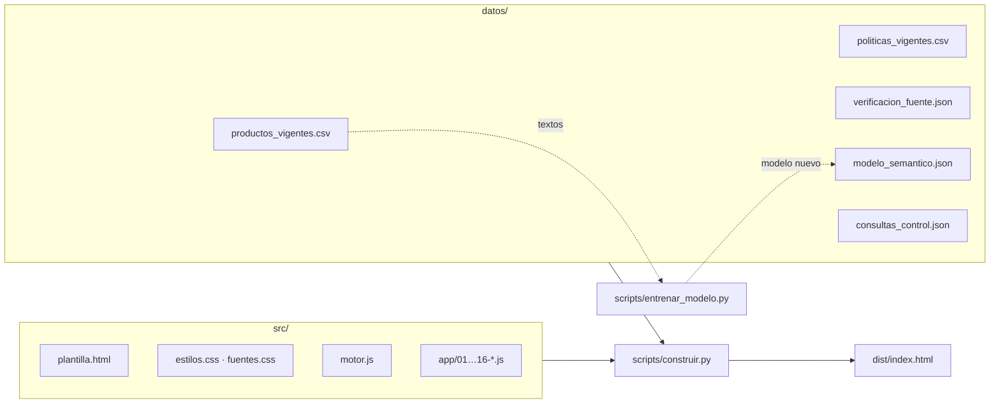

# Arquitectura

## Una sola página, sin servidor

El visor se entrega como **un único archivo HTML** (`dist/index.html`, unos 2,8 MB). Lleva incrustados los datos, el modelo, las tipografías, los estilos y el código. Se eligió así porque:

- **Funciona sin conexión.** Se puede abrir con doble clic, enviar por correo o publicar en cualquier alojamiento estático, como GitHub Pages.
- **No hace peticiones a otros servidores.** Lo que alguien busca no sale de su navegador, y la página no depende de servicios externos que puedan cambiar o desaparecer.
- **Es reproducible.** Mismo `datos/` y mismo `src/` dan el mismo archivo, byte a byte.

Lo que cuesta es el peso inicial: unos 2,8 MB, unos 1,3 MB si el servidor lo comprime con gzip. Y cualquier cambio en los datos exige reconstruir el archivo.

| Parte | Tamaño aproximado |
|---|---|
| Datos de los productos y las políticas, diccionario y formas escritas | 1,2 MB |
| Modelo semántico (matrices en enteros de 8 bits, base64) | 1,35 MB |
| Tipografías (subconjuntos WOFF2 en base64) | 105 kB |
| Código de la aplicación y del motor | 130 kB |
| Estilos y plantilla | 45 kB |

`scripts/construir.py` hace fallar la construcción si el archivo pasa de 3,1 MB.

## Del repositorio a la página

### Qué hace `scripts/construir.py`

Solo usa la biblioteca estándar de Python.

1. **Lee y valida los datos.** Comprueba:
   - que no haya identificadores repetidos;
   - que el CSV y el modelo tengan los mismos productos en el mismo orden;
   - que los conteos por política coincidan con el catálogo;
   - que el vocabulario y la columna `df` del modelo correspondan a los textos de los productos;
   - que los enlaces a los planes de acción vayan a sdp.gov.co, y los de los documentos de política, a sitios oficiales del Distrito;
   - que todas las entidades estén en `datos/catalogos/entidades.csv`;
   - que la verificación de la fuente sea coherente;
   - que `datos/datapackage.json` traiga el tamaño y la huella SHA-256 reales de cada archivo, y la misma versión que `CITATION.cff`;
   - que los tamaños de las matrices correspondan;
   - que existan los productos esperados de las consultas de control.
2. **Calcula lo que el visor necesita y no está en los datos:**
   - las familias de color de los sectores;
   - los nombres cortos de las políticas;
   - la máscara de enfoques normalizados;
   - el diccionario de 700 unidades de significado;
   - las palabras frecuentes en el plan de cada política;
   - la forma escrita más común de cada término, los nombres normalizados de las entidades y la marca «…» de los textos recortados;
   - los textos sin correos de personas (dos dependencias los traen en la fuente).
3. **Compacta los datos.** Los textos que se repiten (entidades, dependencias, resultados, objetivos) van en una tabla de cadenas, y cada producto guarda índices a esa tabla.
4. **Arma la página.**
   - Escribe en la plantilla la fecha de corte y los totales, tomados de `verificacion_fuente.json`.
   - Inserta tipografías, estilos, motor, aplicación y datos en sus marcas (`/*__FONTS__*/`, `/*__STYLES__*/`, `/*__ENGINE_JS__*/`, `/*__APP_JS__*/`, `__DATA_JSON__`), en una sola pasada: lo insertado no se vuelve a leer en busca de marcas.
   - Une los módulos de `src/app/` en orden alfabético dentro de una sola función, que comparte el ámbito.
5. **Revisa el resultado.** Comprueba:
   - que cada marca de inserción esté exactamente una vez y que no queden marcas sin reemplazar;
   - que la plantilla solo enlace a sdp.gov.co;
   - que las palabras vacías del motor y las del script sean las mismas;
   - que la página no pase del presupuesto de peso.

`python3 scripts/construir.py --comprobar` construye en memoria y falla si `dist/index.html` no está al día. La integración continua lo usa.

Otras dos opciones:
- `--huellas` actualiza en `datos/datapackage.json` el tamaño, la huella de cada archivo y la versión. Hay que correrla cuando cambia un archivo de `datos/` o la versión.
- `--csp --salida ruta.html` escribe una variante de ensayo con política de seguridad de contenido (ver [Seguridad](#seguridad)). No reemplaza a `dist/index.html`.

### Los datos dentro de la página

Van como JSON en `<script id="data" type="application/json">`, con estas claves:

| Clave | Contenido |
|---|---|
| `fams`, `sectors`, `sec2fam` | Familias de color, sectores y a qué familia pertenece cada sector |
| `pols` | Políticas: instrumento, nombre, nombre corto, sector líder, número de productos, enlaces al plan (`pa`) y al documento (`doc`) y palabras frecuentes en su plan (`kw`) |
| `strs` | Tabla de cadenas repetidas |
| `pp` | Productos, por columnas: `pol`, `cod`, `pr` (nombre), `ind`, `ent`, `dep`, `meta`, `res`, `obj`, `enf` (máscara de bits de enfoques) |
| `enfs` | Las nueve etiquetas de enfoque |
| `dict` | Las 700 unidades de significado, en su forma escrita más común |
| `formas` | Forma escrita más común de cada término del vocabulario que se escribe distinto («genero» → «género»), para mostrarlo al público |
| `model` | El modelo semántico (ver [datos](datos.md#modelo_semanticojson)), más `frecuentes`, las palabras que descartó por aparecer en más del 20 % de los productos, y `ocultos`, los términos que son residuos de la extracción y no se muestran |
| `tests` | Las consultas de control |
| `verif` | Resumen de la verificación de la fuente |
| `corte` | Fecha de corte, en forma larga y corta |
| `version` | Versión del visor, tomada de `CITATION.cff` |
| `entidades` | Cuántas formas de escritura de las entidades se agrupan en cuántas entidades |
| `verif.excluidos` | Planes excluidos, con las palabras clave que activan el aviso al buscar |

## El motor: `src/motor.js`

Es una función, `createEngine(modelo, decodificadorBase64)`. Corre igual en el navegador y en Node, y las pruebas lo cargan con `require`. No toca la página.

| Función | Qué hace |
|---|---|
| `tokens`, `resolve` | Leen una palabra igual que el entrenamiento. Si no está en el vocabulario, sugieren la más parecida: primero por prefijo y después por distancia de edición de 2 o menos. |
| `wordUnit`, `phraseUnit`, `docUnit` | Construyen la unidad que se busca: una palabra, una expresión o un producto de referencia |
| `queryUnits` | Calcula la relación de cada producto con la búsqueda completa y con cada unidad |
| `unitNeighbors`, `unitSim` | Palabras y expresiones vecinas, y similitud entre unidades |
| `buildIndex`, `findDocs` | Índice de posiciones de los textos, para encontrar menciones literales de una expresión |
| `parse`, `suggest`, `marks` | Reconocen expresiones al escribir, sugieren y marcan el texto coincidente |
| `loadDict`, `groupAffinity` | Cargan el diccionario y calculan la afinidad entre políticas |

**Cómo carga.** Las matrices se decodifican una vez al abrir la página, unos 20 ms en un portátil. El índice de textos y el diccionario se arman por tandas de 10 ms después de pintar la página, para no bloquearla. Si alguien busca una expresión antes de que terminen, se arman de inmediato.

## La aplicación: `src/app/`

Son 16 archivos que se concatenan en orden. **No son módulos ES**: comparten variables (`D`, `E`, `S`, `R`, `SK`…), y por eso el número del nombre fija el orden.

| Archivo | Responsabilidad |
|---|---|
| `01-utilidades.js` | Creación de nodos (`h`), formato de números, funciones hash y geometría básica |
| `02-datos-y-motor.js` | Lee los datos, crea el motor, umbrales y bandas, y arma el índice en segundo plano |
| `03-estado.js` | Estado de la búsqueda (`S`) y resultado calculado (`R`): relacionados, filtros, etiquetas de relación |
| `04-direccion.js` | La búsqueda vive en la dirección (`#q-…`), para compartir y para el botón atrás |
| `05-busqueda.js` | Campo de búsqueda, fichas de palabras, sugerencias, mensajes y recorrido de búsquedas |
| `06-panel-de-resultados.js` | Filtros, resumen, lista de productos, fichas, «Productos parecidos» y «Copiar tabla» |
| `07-nube-base.js` | Lienzo, cámara, plano de fondo y utilidades de dibujo de la nube |
| `08-nube-composicion.js` | Ubica palabras, vecinas, políticas, productos y bandas sin que se pisen |
| `09-nube-dibujo.js` | Dibuja la escena y la capa de resaltado |
| `10-nube-bucle-camara-y-foco.js` | Bucle de animación (se detiene a los 5 s sin interacción), acercamiento y foco en una política |
| `11-nube-fichas.js` | Fichas emergentes de productos, políticas y palabras vecinas |
| `12-nube-interaccion.js` | Detección de lo que hay bajo el cursor o el dedo, clic y toque |
| `13-nube-leyenda.js` | Leyenda, índice de políticas en la figura y texto alternativo de la nube |
| `14-validacion.js` | Corre las consultas de control en el navegador |
| `15-fuente-y-metodo.js` | Arma la sección «Fuente y método» al abrirla |
| `16-arranque.js` | Cabecera, leyenda de bandas, eventos globales y primer pintado |

Algunos nombres internos vienen de versiones anteriores. Por ejemplo, `SK.stars` son los puntos de los productos.

## Dibujo y rendimiento

- **Lienzo.** La nube se dibuja en un `<canvas>` con densidad de píxeles del dispositivo. La escena estática se guarda en un lienzo aparte y solo se vuelve a pintar cuando cambia la cámara, la búsqueda o el elemento resaltado.
- **Composición estable.** La posición de cada elemento se calcula con funciones deterministas, como un hash del nombre. La misma búsqueda produce siempre la misma figura.
- **Ahorro de batería.** La animación de partículas se detiene a los 5 s sin interacción (WCAG 2.2.2), cuando la nube sale de la pantalla o cuando la pestaña queda oculta. No se anima si el sistema pide reducir el movimiento.

## Accesibilidad

- **Equivalente en texto.** La nube tiene un texto alternativo que se actualiza con cada búsqueda. La lista de productos contiene la misma información que la figura.
- **Nombres accesibles.** El nombre de cada botón es su contenido: empieza por el texto que se ve y sigue con un detalle oculto a la vista (clase `sr-only`), como el nivel de banda de cada política. No se usa `aria-label` sobre botones con texto visible (WCAG 2.5.3).
- **Teclado.**
  - Las flechas recorren los productos en orden de relación.
  - Más y menos acercan y alejan.
  - Esc vuelve a la vista completa.
  - «/» lleva al campo de búsqueda.
  - Un enlace de salto lleva directo a la lista.
- **Color.** No es el único portador de información: leyenda, rótulos y fichas repiten lo que codifica. La paleta se validó para contraste y para visión de color atípica.

## Pruebas

| Prueba | Qué comprueba | Necesita |
|---|---|---|
| `scripts/construir.py --comprobar` | Datos coherentes y `dist/` al día | Python |
| `pruebas/validar_modelo.js` | Las 7 consultas de control | Node |
| `pruebas/probar_unidades.js` | Índice de textos completo, diccionario, reconocimiento de expresiones y equivalencia con el motor original | Node |
| `pruebas/cifras_de_referencia.js` | Que las cifras citadas en el visor y en la metodología correspondan al modelo | Node |
| `pruebas/recorrido_chrome.py` | Recorrido en escritorio y teléfono, sin errores de consola | Playwright y Chrome |
| `pruebas/funciones_chrome.py` | Búsqueda, filtros, perfiles, productos parecidos, dirección y atajos | Playwright y Chrome |
| `pruebas/medir_chrome.py` | Ocho tamaños de pantalla: sin desbordes, nube en la primera pantalla y animación en pausa | Playwright y Chrome |
| `pruebas/webkit_iphone.py` | El motor de Safari en tamaño de iPhone (se corre aparte: `xvfb-run -a python3 pruebas/webkit_iphone.py "$PWD/dist/index.html" capturas`) | WebKitGTK con PyGObject y xvfb, desde los paquetes del sistema (no usa Playwright) |

`python3 pruebas/verificar.py` corre todo salvo WebKit; con `--rapido`, solo lo que no necesita navegador. La integración continua (`.github/workflows/verificar.yml`) tiene tres trabajos:
- la verificación rápida, con las versiones mínimas (Python 3.9 y Node 18) y con las actuales;
- los recorridos y funciones en Chrome (`--solo-navegador`), que también bloquean;
- las medidas en píxeles (`--solo-medidas`), con 2 px de tolerancia, que solo informan porque dependen de la versión de Chrome.

La publicación en GitHub Pages espera a que la verificación pase.

## Seguridad

- **Sin HTML dinámico.** La página crea sus nodos con `h()` y `textContent`: no usa `innerHTML`, `eval` ni manejadores en atributos. Los datos van como JSON con «<» escapado.
- **Sin red.** No hay peticiones, cookies ni almacenamiento local. Los únicos enlaces salen a sitios oficiales del Distrito, validados al construir, y no envían la dirección de origen (`no-referrer`).
- **Copiar tabla.** Si una celda empieza como una fórmula (`=`, `+`, `@` o un guion que no es un número), se copia con un apóstrofo delante para que la hoja de cálculo la lea como texto.
- **Publicación.** `publicar.yml` solo publica cambios que ya están en la rama `main` de este repositorio. Una solicitud de cambio enviada desde una bifurcación no puede dispararlo, aunque su rama se llame `main`.
- **Política de seguridad de contenido (CSP).** `python3 scripts/construir.py --csp --salida /tmp/visor_csp.html` genera una variante que solo deja correr los scripts y estilos del archivo, identificados por su huella. Pasa todos los recorridos en Chrome. Falta probarla en Safari antes de adoptarla, y por eso no va en `dist/index.html`.
- **Avisos de seguridad.** Ver [SECURITY.md](../SECURITY.md).

## Decisiones que conviene conocer antes de cambiar algo

- **El modelo no se recalcula al construir.** `construir.py` solo lo copia. Para cambiarlo hay que entrenar con `scripts/entrenar_modelo.py`, revisar el resultado y actualizar las consultas de control (ver [actualizar los datos](actualizar-datos.md)).
- **Las reglas de palabras viven en dos sitios:** `src/motor.js` y `scripts/construir.py`. La construcción falla si las palabras vacías difieren.
- **Los umbrales están en el código** (0,18, 0,30 y los de las bandas, en `02-datos-y-motor.js`) **y en la documentación.** Si cambian, hay que actualizar ambos y correr `pruebas/cifras_de_referencia.js`.
- **Sin dependencias en el navegador:** ni bibliotecas ni marcos. Cualquier dependencia nueva tendría que incrustarse en el archivo.
